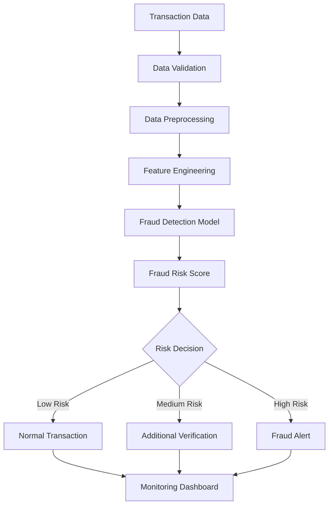

# AI4LIFE — Credit Card Fraud Detection


> AI-powered Fraud Detection and Early Warning System for Financial Transactions.

## 1. Project Overview — Giới thiệu dự án

AI4LIFE — Credit Card Fraud Detection là dự án nghiên cứu và phát triển hệ thống ứng dụng Machine Learning nhằm phát hiện các giao dịch tài chính bất thường, nhận diện nguy cơ gian lận và hỗ trợ cảnh báo sớm.

Dự án hướng đến việc xây dựng một giải pháp hỗ trợ các ngân hàng, tổ chức tài chính, doanh nghiệp FinTech và hệ thống thanh toán điện tử trong việc quản lý rủi ro giao dịch, giảm thiểu tổn thất tài chính và nâng cao khả năng bảo vệ khách hàng.

Không chỉ tập trung vào bài toán phân loại giao dịch, dự án còn hướng đến việc nghiên cứu những hạn chế của các hệ thống phát hiện gian lận hiện tại và khả năng ứng dụng AI vào môi trường tài chính thực tế.

## 2. Problem Statement — Bài toán cần giải quyết

Mặc dù các hệ thống bảo mật tài chính ngày càng phát triển, gian lận giao dịch vẫn là một thách thức lớn đối với ngân hàng, doanh nghiệp và người dùng.

Các vấn đề chính bao gồm:

- Gian lận thẻ tín dụng và giao dịch trái phép.
- Đánh cắp thông tin thẻ và giả mạo thẻ.
- Các phương thức gian lận liên tục thay đổi.
- Dữ liệu mất cân bằng nghiêm trọng (Imbalanced Data).
- Khó phát hiện các hình thức gian lận chưa từng xuất hiện.
- Cảnh báo nhầm đối với các giao dịch hợp lệ.
- Sự đánh đổi giữa khả năng phát hiện gian lận và trải nghiệm khách hàng.
- Yêu cầu xử lý giao dịch và cảnh báo với độ trễ thấp.

Câu hỏi nghiên cứu trọng tâm:

**How can we improve fraud detection capabilities while minimizing false alarms and operational costs?**

## 3. Project Objectives — Mục tiêu dự án

### Research Objectives

- Nghiên cứu nguyên nhân và những thách thức trong việc phát hiện gian lận tài chính.
- Phân tích đặc điểm và hành vi của các giao dịch bất thường.
- Nghiên cứu, so sánh các phương pháp Machine Learning trong Fraud Detection.
- Đánh giá khả năng phát hiện gian lận trên dữ liệu mất cân bằng.
- Nghiên cứu khả năng thích ứng với các hình thức gian lận mới.
- Tối ưu sự cân bằng giữa Fraud Detection và False Positive Rate.

### Product Objectives

- Xây dựng hệ thống tự động đánh giá mức độ rủi ro của giao dịch.
- Phát hiện và cảnh báo các giao dịch có dấu hiệu gian lận.
- Cung cấp Fraud Risk Score cho từng giao dịch.
- Hỗ trợ ưu tiên các giao dịch cần được xác minh.
- Xây dựng hệ thống có khả năng tích hợp với các ứng dụng tài chính.
- Phát triển dashboard hỗ trợ giám sát và phân tích rủi ro.

## 4. Proposed Approach — Phương pháp tiếp cận

### Data Engineering

- Data Collection
- Exploratory Data Analysis (EDA)
- Data Cleaning
- Feature Engineering
- Imbalanced Data Handling
- Data Leakage Prevention
- Train / Validation / Test Split

### Machine Learning

Các mô hình dự kiến nghiên cứu và thực nghiệm:

- Rule-based Baseline
- Logistic Regression
- Random Forest
- XGBoost
- LightGBM
- Isolation Forest
- Hybrid Fraud Detection Models

Việc lựa chọn mô hình cuối cùng sẽ dựa trên kết quả thực nghiệm, khả năng phát hiện gian lận, chi phí cảnh báo nhầm và tính khả thi khi triển khai.

### System Engineering

- Transaction Processing Pipeline
- Model Training Pipeline
- Fraud Risk Scoring
- Decision Threshold Optimization
- Inference API
- Early Warning System
- Monitoring Dashboard

## 5. Proposed System Architecture



Hệ thống đóng vai trò hỗ trợ ra quyết định và quản lý rủi ro, không mặc định tự động kết luận hoặc chặn mọi giao dịch được cảnh báo.

## 6. Evaluation Metrics — Tiêu chí đánh giá

Do đặc thù mất cân bằng dữ liệu, Accuracy không được sử dụng làm tiêu chí đánh giá chính.

| Metric | Purpose | Priority |
|---|---|---|
| Average Precision (AP) | Đánh giá chất lượng mô hình trên dữ liệu mất cân bằng | Primary |
| Recall@K | Khả năng phát hiện gian lận với ngân sách cảnh báo cố định | Primary |
| Recall | Tỷ lệ gian lận được phát hiện | High |
| Precision | Độ tin cậy của cảnh báo | High |
| False Positive Rate | Tỷ lệ giao dịch hợp lệ bị cảnh báo nhầm | High |
| Precision@K | Chất lượng các giao dịch được ưu tiên kiểm tra | High |
| F1-score | Cân bằng Precision và Recall | Secondary |
| ROC-AUC | Khả năng phân biệt hai lớp | Secondary |
| Alert Rate | Tỷ lệ giao dịch bị cảnh báo | Business |
| Fraud Amount Recall | Tỷ lệ giá trị gian lận được phát hiện | Business |
| P95 Inference Latency | Độ trễ dự đoán của hệ thống | System |

### Optimization Objective

**Maximize fraud detection capability while controlling false alarms and operational costs.**

Các mô hình phải được đánh giá trên cùng điều kiện dữ liệu và quy trình thực nghiệm. Ngưỡng cảnh báo được lựa chọn trên validation set, không tối ưu trực tiếp trên test set.

## 7. Team Members — Thành viên

| Member | Role | Responsibilities |
|---|---|---|
| Trịnh Gia Huy | AI Engineer — Model | Model research, training, evaluation, optimization |
| Nguyễn Đức Thông | AI Engineer — Data | Data collection, EDA, preprocessing, feature engineering |
| Phạm Đức Anh | AI Engineer — Pipeline | Training pipeline, inference pipeline, API integration |
| Trần Phúc Khánh | Tech Leader | System architecture, technical management, integration, dashboard |
| Hồ Nguyễn Thuỳ Dung | QA / Reviewer | Testing, code review, evaluation validation, quality assurance |

## 8. Proposed Repository Structure

```text
AI4LIFE-Credit-Card-Fraud-Detection/
│
├── data/
│   └── README.md
│
├── notebooks/
│
├── src/
│   ├── preprocessing/
│   ├── features/
│   ├── models/
│   ├── evaluation/
│   ├── pipeline/
│   └── api/
│
├── dashboard/
├── configs/
├── experiments/
├── tests/
├── docs/
├── .github/
│   └── workflows/
│
├── .gitignore
├── .env.example
├── requirements.txt
└── README.md
```

## 9. Project Roadmap

### Phase 1 — Minimum Viable Product (2 Weeks)

- [ ] Research related papers and existing solutions
- [ ] Select and analyze datasets
- [ ] Establish data preprocessing pipeline
- [ ] Define evaluation protocol and metrics
- [ ] Implement baseline models
- [ ] Train and compare candidate models
- [ ] Optimize decision threshold
- [ ] Build inference API
- [ ] Develop basic monitoring dashboard
- [ ] Integrate end-to-end fraud detection pipeline
- [ ] Conduct testing and error analysis
- [ ] Deliver MVP demonstration

### Phase 2 — Research & Optimization

- [ ] Advanced feature engineering
- [ ] Anomaly detection
- [ ] Hybrid fraud detection models
- [ ] Unseen fraud pattern detection
- [ ] Explainable AI (XAI)
- [ ] Cost-sensitive learning
- [ ] Model robustness evaluation

### Phase 3 — Real-world Deployment Research

- [ ] Real-time transaction processing
- [ ] Model monitoring
- [ ] Data drift and concept drift detection
- [ ] Scalable system architecture
- [ ] Human-in-the-loop fraud investigation
- [ ] Financial system integration

## 10. Proposed Technology Stack

| Category | Technologies |
|---|---|
| Programming Language | Python |
| Data Processing | Pandas, NumPy |
| Machine Learning | Scikit-learn, XGBoost, LightGBM |
| Visualization | Matplotlib, Seaborn |
| API Development | FastAPI |
| Dashboard | Streamlit |
| Testing | Pytest |
| Version Control | Git, GitHub |
| Experiment Tracking | MLflow |
| Deployment | Docker |

The final technology stack will be determined based on project requirements and experimental results.

## 11. Collaboration Workflow

The team follows a collaborative Git workflow:

- `main`: Stable version.
- `dev`: Development and integration.
- `feat/*`: New features.
- `fix/*`: Bug fixes.
- `test/*`: Testing and validation.
- `research/*`: Research and experiments.

### Contribution Guidelines

1. Create or select an assigned GitHub Issue.
2. Create a new branch from `dev`.
3. Implement and test the assigned feature.
4. Commit changes with clear commit messages.
5. Create a Pull Request to `dev`.
6. Request code review.
7. Merge after approval.

Direct commits to shared branches should be avoided.

## 12. Expected Outcomes — Kết quả mong đợi

- A reproducible fraud detection pipeline.
- A benchmark of multiple Machine Learning models.
- An optimized fraud risk scoring model.
- An early warning mechanism for suspicious transactions.
- A functional inference API and monitoring dashboard.
- An experimental report with evaluation results and error analysis.
- A foundation for future research and real-world financial applications.

## 13. Data Privacy & Responsible AI

- Do not commit sensitive financial or personal information.
- Do not upload confidential datasets or customer transaction records.
- Do not expose credentials, API keys or environment variables.
- Use authorized, anonymized or synthetic datasets.
- Document model limitations and potential risks.

This project is currently intended for research and educational purposes. Production deployment requires additional security, privacy, compliance and reliability validation.

## 14. Research & References

Research papers, dataset references, experimental methodologies and technical documentation will be maintained in the `docs/` directory.

---

**AI4LIFE Team**

Building intelligent, reliable and practical AI solutions for financial fraud detection.
