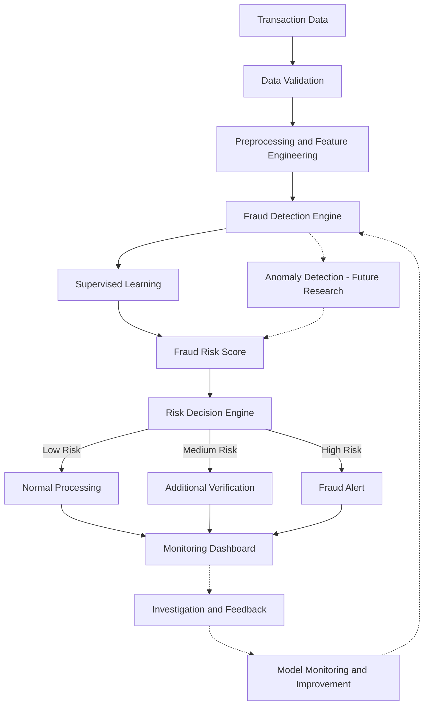

<div align="center">

# AI4LIFE
### Credit Card Fraud Detection & Early Warning System

**Leveraging Machine Learning to Detect Financial Fraud, Assess Transaction Risk, and Enable Early Intervention.**


[Overview](#overview) ·
[Research](#research-focus) ·
[Architecture](#system-architecture) ·
[Evaluation](#evaluation-framework) ·
[Roadmap](#development-roadmap) ·
[Team](#team)

</div>

---

## Overview

Financial fraud remains a critical challenge for banks, financial institutions, payment platforms, and their customers.

Despite advances in cybersecurity and financial technology, fraudulent transactions continue to evolve, exposing limitations in conventional rule-based fraud detection systems.

**AI4LIFE** is a research-oriented AI engineering project focused on developing an intelligent fraud detection and early warning system capable of identifying suspicious credit card transactions, assessing transaction-level risk, and supporting timely decision-making.

The project bridges Machine Learning research and practical financial risk management, with an emphasis on detection effectiveness, reliability, and real-world applicability.

### Mission

> Make financial transactions safer through intelligent, reliable, and practical AI solutions.

### Vision

Develop a scalable fraud risk assessment framework that could serve as a foundation for future integration into banking, FinTech, and digital payment ecosystems.

---

## Problem Statement

Fraud detection is not simply a binary classification problem. It is a complex financial risk management challenge characterized by:

| Challenge | Description |
|---|---|
| Class Imbalance | Fraudulent transactions represent a small fraction of total transactions. |
| Evolving Fraud Patterns | Fraud strategies continuously adapt to existing security mechanisms. |
| False Positives | Incorrect alerts create operational costs and disrupt legitimate customers. |
| Emerging Threats | Previously unseen fraud patterns may not be recognized by existing models. |
| Detection Latency | Delayed detection may reduce opportunities for intervention. |
| Financial Impact | Different fraudulent transactions may result in different levels of financial loss. |
| Explainability | Financial institutions need understandable and actionable risk assessments. |

The central challenge is to improve fraud detection without introducing excessive false alarms or unnecessary friction into legitimate transactions.

---

## Research Focus

The project investigates the following research questions:

- **RQ1:** What limitations allow fraudulent transactions to remain undetected despite existing security and fraud detection mechanisms?

- **RQ2:** How can Machine Learning improve fraud detection under highly imbalanced data distributions?

- **RQ3:** How can supervised and unsupervised learning methods complement each other in identifying suspicious transactions?

- **RQ4:** How can detection thresholds be optimized to balance fraud coverage, false alarms, and operational costs?

- **RQ5:** How can fraud detection models remain effective when transaction patterns and fraud strategies evolve over time?

- **RQ6:** How can a fraud detection model be transformed into a practical early warning and risk assessment system?

### Research Hypothesis

Combining effective transaction representation, appropriate learning methods, and risk-aware decision thresholds may improve fraud detection performance compared with conventional baseline approaches.

This hypothesis will be evaluated through controlled experiments.

---

## Project Objectives

### Research Objectives

- Investigate financial fraud patterns and detection challenges.
- Analyze transaction behavior and informative risk indicators.
- Benchmark multiple Machine Learning approaches.
- Evaluate performance under class imbalance.
- Investigate anomaly detection and emerging fraud patterns.
- Conduct reproducible experiments and systematic error analysis.

### Engineering Objectives

- Develop a reproducible data processing pipeline.
- Build transaction-level fraud risk scoring models.
- Implement configurable risk-based decision mechanisms.
- Develop an inference API for transaction assessment.
- Build an interactive fraud monitoring dashboard.
- Establish automated testing and validation workflows.

### Business Objectives

- Improve fraud detection coverage.
- Reduce unnecessary fraud alerts.
- Prioritize high-risk transactions for investigation.
- Support timely intervention and additional verification.
- Provide a foundation for financial risk management applications.

---

## System Architecture

The following diagram represents the proposed system architecture.



The system is designed to support risk-based decisions rather than automatically treating every suspicious transaction as confirmed fraud.

Dashed connections represent potential future extensions.

---

## Machine Learning Strategy

The project adopts an experimental, baseline-driven development strategy.

### Supervised Learning

| Model | Purpose |
|---|---|
| Logistic Regression | Interpretable baseline |
| Random Forest | Nonlinear classification benchmark |
| XGBoost | Gradient boosting benchmark |
| LightGBM | Additional boosting candidate |

### Unsupervised Learning — Future Research

| Model | Purpose |
|---|---|
| Isolation Forest | Anomaly detection |
| Autoencoder | Learning normal transaction representations |

### Hybrid Approaches — Future Research

Potential combinations include:

- Supervised classification and anomaly detection.
- Cost-sensitive learning and threshold optimization.
- Behavioral features and transaction risk scoring.
- Ensemble-based fraud detection.

Model selection will be driven by experimental evidence rather than model complexity alone.

---

## Evaluation Framework

Accuracy is not considered a primary evaluation metric due to the highly imbalanced nature of fraud detection datasets.

### Primary Metrics

| Metric | Evaluation Objective |
|---|---|
| Average Precision (AP) | Measure fraud ranking quality across decision thresholds. |
| Recall at Fixed Alert Budget | Maximize fraud coverage within investigation capacity. |

### Secondary Metrics

| Metric | Evaluation Objective |
|---|---|
| Recall | Measure detected fraudulent transactions. |
| Precision | Measure the reliability of fraud alerts. |
| False Positive Rate | Measure incorrect alerts on legitimate transactions. |
| Precision@K | Measure alert quality within the top-K transactions. |
| F1-score | Balance precision and recall. |
| ROC-AUC | Measure overall discrimination capability. |

### Business & System Metrics

| Metric | Evaluation Objective |
|---|---|
| Alert Rate | Measure operational investigation workload. |
| Fraud Amount Recall | Measure the proportion of fraudulent transaction value detected, when supported by the dataset. |
| P95 Inference Latency | Measure transaction assessment latency. |

### Optimization Objective

> Maximize fraud detection capability while controlling false alarms and operational costs.

### Evaluation Protocol

- Use consistent datasets and evaluation conditions across models.
- Prefer chronological data splitting when timestamps are available.
- Prevent data leakage during preprocessing and feature engineering.
- Fit preprocessing and resampling methods using training data only.
- Optimize decision thresholds on validation data.
- Reserve the test set for final evaluation.
- Compare candidate models against established baselines.
- Document experimental configurations and limitations.

### Experimental Results

| Model | AP | Recall | Precision | FPR | Recall@K |
|---|---:|---:|---:|---:|---:|
| Logistic Regression | — | — | — | — | — |
| Random Forest | — | — | — | — | — |
| XGBoost | — | — | — | — | — |
| LightGBM | — | — | — | — | — |

*Experimental results will be published after model training and validation.*

---

## Technology Stack

The following stack is proposed and may evolve throughout development.

| Layer | Technology |
|---|---|
| Programming | Python |
| Data Engineering | Pandas, NumPy |
| Machine Learning | Scikit-learn, XGBoost, LightGBM |
| Experiment Tracking | MLflow |
| API | FastAPI |
| Visualization | Matplotlib, Plotly |
| Dashboard | Streamlit |
| Testing | Pytest |
| Version Control | Git, GitHub |
| CI/CD | GitHub Actions |
| Containerization | Docker |

---

## Repository Structure

The proposed repository structure follows a modular AI engineering architecture.

```text
AI4LIFE-Credit-Card-Fraud-Detection/
│
├── configs/                # Experiment and system configurations
├── data/                   # Dataset documentation and local data
├── notebooks/              # EDA and exploratory experiments
├── experiments/            # Experiment configurations and results
│
├── src/
│   ├── preprocessing/      # Data validation and preprocessing
│   ├── features/           # Feature engineering
│   ├── models/             # Model implementations
│   ├── training/           # Model training
│   ├── evaluation/         # Metrics and error analysis
│   ├── pipeline/           # End-to-end ML pipeline
│   └── api/                # Inference services
│
├── dashboard/              # Monitoring and visualization
├── tests/                  # Unit and integration tests
├── docs/                   # Research and technical documentation
├── scripts/                # Utility and execution scripts
│
├── .github/
│   └── workflows/          # Automated CI/CD workflows
│
├── .gitignore
├── .env.example
├── requirements.txt
├── CONTRIBUTING.md
└── README.md
```

---

## Development Roadmap

### Phase 01 — MVP

**Duration: 2 weeks**

The objective is to deliver a functional and reproducible end-to-end fraud detection prototype.

- [ ] Review existing research and fraud detection approaches.
- [ ] Select and analyze an appropriate dataset.
- [ ] Establish preprocessing and feature engineering pipelines.
- [ ] Define evaluation metrics and experimental protocols.
- [ ] Implement Logistic Regression as the baseline.
- [ ] Train and evaluate candidate classification models.
- [ ] Optimize risk decision thresholds.
- [ ] Implement transaction inference API.
- [ ] Develop a basic fraud monitoring dashboard.
- [ ] Integrate and validate the end-to-end system.
- [ ] Deliver MVP demonstration and experimental report.

**Definition of Done**

A working prototype capable of receiving transaction features, generating a fraud risk score, producing a risk-based alert, and displaying the result through a basic monitoring interface.

### Phase 02 — Advanced Research

- [ ] Advanced feature engineering.
- [ ] Unsupervised anomaly detection.
- [ ] Hybrid fraud detection models.
- [ ] Cost-sensitive learning.
- [ ] Explainable AI.
- [ ] Emerging fraud pattern evaluation.
- [ ] Model robustness and temporal validation.

### Phase 03 — Production-Oriented Research

- [ ] Real-time transaction processing.
- [ ] Model monitoring.
- [ ] Data drift and concept drift detection.
- [ ] Investigation feedback mechanisms.
- [ ] Scalability and performance optimization.
- [ ] Security and financial system integration assessment.

---

## Potential Applications

| Domain | Potential Application |
|---|---|
| Banking | Credit card transaction risk assessment |
| FinTech | Suspicious transaction monitoring |
| Digital Payments | Transaction-level fraud screening |
| E-commerce | Payment fraud risk assessment |
| Financial Institutions | Investigation prioritization and decision support |

The project aims to explore practical applications while recognizing that real-world financial deployment requires additional validation, security controls, compliance assessment, and domain expertise.

---

## Getting Started

The project is currently under active development.

Installation instructions, dataset preparation, training commands, API documentation, and demonstration examples will be provided as the MVP components become available.

---

## Team

| Member | Role | Area of Responsibility |
|---|---|---|
| Trịnh Gia Huy | AI Engineer — Model | Model research, training, evaluation and optimization |
| Nguyễn Đức Thông | AI Engineer — Data | Data analysis, preprocessing and feature engineering |
| Phạm Đức Anh | AI Engineer — Pipeline | ML pipeline, inference services and API integration |
| Trần Phúc Khánh | Tech Leader | System architecture, technical direction and integration |
| Hồ Nguyễn Thuỳ Dung | QA / Reviewer | Testing, code review and experimental validation |

---

## Contribution Workflow

The project follows a collaborative Git development workflow.

| Branch | Purpose |
|---|---|
| `main` | Stable project version |
| `dev` | Development and integration |
| `feat/*` | Feature development |
| `fix/*` | Bug fixes |
| `research/*` | Research and experiments |
| `docs/*` | Documentation |
| `test/*` | Testing and validation |

All contributors are encouraged to:

1. Create or select an assigned GitHub Issue.
2. Create a dedicated branch from `dev`.
3. Implement and test the assigned task.
4. Follow Conventional Commits.
5. Submit a Pull Request.
6. Request peer review before merging.

Examples:

```text
feat(model): implement logistic regression baseline
feat(data): add transaction preprocessing pipeline
fix(pipeline): resolve feature schema mismatch
test(model): validate evaluation metrics
docs: update system architecture
```

---

## Research & Documentation

Research papers, experiment reports, architecture decisions, dataset documentation, and technical references will be maintained in the `docs/` directory.

The project emphasizes:

- Scientific reasoning.
- Reproducible experimentation.
- Evidence-based model selection.
- Transparent evaluation.
- Collaborative engineering practices.

---

## Responsible AI & Data Privacy

Financial data requires careful handling and responsible use.

- Use authorized, anonymized, or synthetic datasets.
- Never commit sensitive customer or financial information.
- Never expose credentials, API keys, or secrets.
- Document model limitations and potential failure modes.
- Evaluate both missed fraud and incorrect alerts.
- Maintain human oversight for high-impact financial decisions.

This project is intended for educational and research purposes and is not currently validated for production financial decision-making.

---

<div align="center">

### AI4LIFE

**Research Driven · Engineering Focused · Impact Oriented**

Building intelligent AI solutions for a safer financial ecosystem.

</div>
