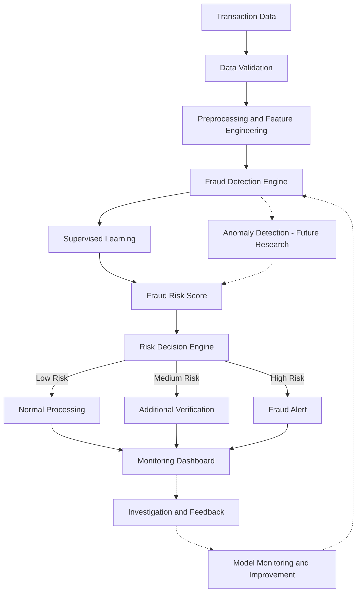

## System Architecture

The following diagram represents the proposed system architecture.

The system is designed to support risk-based decisions rather than automatically treating every suspicious transaction as confirmed fraud.

Dashed connections represent potential future extensions.

---

## Machine Learning Strategy

The project adopts an experimental, baseline-driven development strategy.

### Supervised Learning

| Model | Purpose |
|---|---|
| Logistic Regression | Interpretable baseline |
| Random Forest | Nonlinear classification benchmark |
| XGBoost | Gradient boosting benchmark |
| LightGBM | Additional boosting candidate |

### Unsupervised Learning — Future Research

| Model | Purpose |
|---|---|
| Isolation Forest | Anomaly detection |
| Autoencoder | Learning normal transaction representations |

### Hybrid Approaches — Future Research

Potential combinations include:

- Supervised classification and anomaly detection.
- Cost-sensitive learning and threshold optimization.
- Behavioral features and transaction risk scoring.
- Ensemble-based fraud detection.

Model selection will be driven by experimental evidence rather than model complexity alone.

---